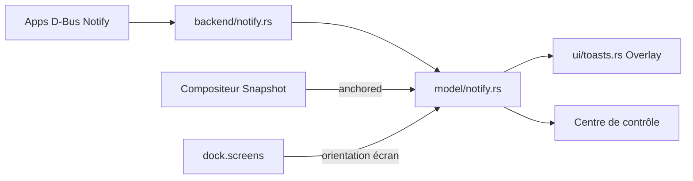

# Requirements

### Overview & Goals

Mettre en place le serveur `org.freedesktop.Notifications` dans le **dock**, afficher des bulles en **layer-shell Overlay iced collées à la barre** (même écran, même orientation, en bout de dock), garder un **historique de session** dans le centre de contrôle, et rendre enfin active la bascule **Ne pas déranger** (manuel + automatique pendant un jeu). Les toasts ne s’affichent **jamais** sur un écran ancré.

### Scope

**In Scope**
- Serveur D-Bus FDO dans le processus `coquille-dock` (même pattern que le tray).
- Toasts : icône, résumé, corps, boutons d’action, image optionnelle ; empilement ; `replaces_id` ; fermeture (timeout, clic, `CloseNotification`).
- Placement : **même écran qu’une barre visible**, bulle **séparée** (surface Overlay, pas dans le widget barre) **en fin de dock** ; format **vertical / horizontal** identique à `Orientation` de cette barre.
- Historique en mémoire jusqu’à déconnexion ou « tout effacer », dans le centre de contrôle.
- NPD : bascule existante du dock ; auto dès qu’au moins un écran est `anchored` dans le `Snapshot` ipc ; les toasts sont masqués, l’historique continue de recevoir.

**Out of Scope**
- Programme `coquille-notify` séparé, persistance disque, sons, réponse inline, urgence critique qui perce le NPD, rendu GLES côté compositeur.
- Réglage d’écran indépendant (`[notifications] screen`) : les bulles suivent le dock.

### User Stories

- En tant qu’utilisateur, je vois les notifications Discord / Steam / Firefox en bulle **au bout de ma barre** (gauche par défaut), pas au milieu du contenu ni devant un jeu.
- En tant que joueur, le NPD s’active tout seul dès qu’un écran est ancré ; je retrouve les messages dans le centre de contrôle.
- En tant qu’utilisateur, je clique une action ou une ligne d’historique pour répondre à l’appli.

### Functional Requirements

- Prendre le nom de bus de session ; `GetServerInformation` : `coquille` / `coquille-dock` / version du crate / spec `1.2`.
- Capacités : `body`, `body-markup` (sous-ensemble sûr), `actions`, `action-icons`, `icon-static`, `persistence` (historique session).
- Timeout : celui du client, sinon ~5 s ; 0 = rester jusqu’à fermeture manuelle.
- Clic corps : `ActionInvoked("default")` si l’action existe, sinon activation de la fenêtre de l’appli via `Command::Activate` si une fenêtre `app` correspond.
- Textes UI en français (bulles, centre, Paramètres).

# Technical Design

### Current Implementation

- `crates/ipc/src/lib.rs` : `Snapshot.screens[].anchored` déjà poussé ; pas d’événement notification.
- Dock : `iced_layershell` multi-surfaces (`Layer::Top` barres, `Layer::Overlay` tiroir) dans `crates/dock/src/app.rs` ; D-Bus tray dans `crates/dock/src/backend/tray.rs` (`zbus`, `Subscription::run`).
- Bascule `Toggle::DoNotDisturb` / `do_not_disturb` dans `app.rs` : mémoire locale, aucun effet (`README.md` du dock).
- Compositeur : `panels.rs` — Overlay au-dessus des fenêtres ; écran ancré sans panneaux du dock.
- Config : `crates/config` (`update` / `with_value`) ; Paramètres : `crates/settings/src/view.rs`.

### Key Decisions

- Serveur **dans le dock**, pas un binaire à part.
- Toasts = **nouvelle surface Overlay iced**, **pas** un popup xdg de la barre. Même écran et même `Orientation` que la barre choisie.
- « Fin du dock » = côté horloge / tray : bas d’une barre verticale, extrémité droite d’une barre horizontale (bord droit si `Vertical(Right)`).
- Plusieurs barres : une seule pile, **première barre encore visible** (non ancrée), ordre gauche → centre → droite.
- Logique pure dans `dock/src/model/notify.rs` ; D-Bus dans `dock/src/backend/notify.rs`.

### Proposed Changes

Le backend D-Bus expose `org.freedesktop.Notifications` sur `/org/freedesktop/Notifications`. Chaque `Notify` devient un `Update` iced. Le modèle enregistre dans l’historique et montre une bulle ssi !NPD et qu’une barre existe sur un écran non ancré ; sinon historique seulement.

NPD auto : `do_not_disturb` effectif = bascule manuelle **ou** `screens.iter().any(|s| s.anchored)`. La bascule UI reste celle du centre ; un jeu la force sans écraser le choix manuel.

Surface toast (`app.rs`, même `layershell_open` que le tiroir) :
- `Layer::Overlay`, `exclusive_zone: 0`, `KeyboardInteractivity::None`.
- `OutputOption` = connecteur de la barre cible.
- Ancres : `Vertical(Left)` → `Left | Bottom` (pile vers le haut) ; `Vertical(Right)` → `Right | Bottom` ; `Horizontal` → `Bottom | Right` (pile vers la gauche). Marge ~`metrics.exclusive_zone` + 8 px pour rester dans la bande du dock sans recouvrir le contenu.
- Carte verre (`palette.glass`) : le long d’une barre verticale, cartes empilées (~220–280 px) ; le long d’une barre horizontale, cartes en rang plus basses. Max ~3 visibles.
- Fermer la surface s’il n’y a plus de bulles ; la recaler si orientation / écran de barre change.

### Data Models / Contracts

```rust
// dock/src/model/notify.rs
pub struct Notice {
    pub id: u32,
    pub app: String,
    pub summary: String,
    pub body: String,
    pub icon: Option<Icon>, // named / file / image-data
    pub actions: Vec<(String, String)>, // key, label
    pub expire_ms: Option<u32>, // None = sticky
    pub image: Option<Image>,
}

pub struct NotifyState {
    pub history: Vec<Notice>, // newest first
    pub visible: Vec<u32>,
    pub user_dnd: bool,
}

impl NotifyState {
    pub fn ingest(&mut self, n: Notice, bars: &[(OutputRole, Orientation)], anchored: &[OutputRole]) -> ToastDecision;
    pub fn toast_bar(&self, bars: &[(OutputRole, Orientation)], anchored: &[OutputRole]) -> Option<(OutputRole, Orientation)>;
    pub fn effective_dnd(&self, any_anchored: bool) -> bool;
}
```

D-Bus : `Notify(...) -> u32`, `CloseNotification(u32)`, `GetCapabilities() -> Vec<String>`, `GetServerInformation() -> (name, vendor, version, spec)` ; signaux `NotificationClosed(id, reason)`, `ActionInvoked(id, action_key)`.

Pas de clé `[notifications]` v1 : l’écran et le format viennent de `[dock.screens]` déjà lus par `dock/src/config.rs`.

### File Structure

- Ajout : `crates/dock/src/model/notify.rs`, `crates/dock/src/backend/notify.rs`, `crates/dock/src/ui/toasts.rs`
- Modifié : `dock/src/app.rs` (Overlay en fin de barre), `dock/src/backend/mod.rs`, `dock/src/ui/drawer.rs`, `dock/README.md`, `docs/phase-5.md`

### Architecture Diagram



### Risks

- Nom de bus déjà pris (plasmashell / `plasma_waitforname`) : échouer clairement, réessayer ; sous coquille le nom doit être libre.
- Markup HTML dangereux : n’autoriser que `<b>`, `<i>`, `<u>`, `&amp;` / `&lt;` / `&gt;` / `&apos;` / `&quot;`.
- `image-data` RGB : décoder hors fil UI, taille max.
- Overlay sur écran ancré : le compositeur retire les panneaux du dock ; ne jamais ouvrir la surface toast sur un `role` ancré.

# Testing

### Validation Approach

Tests unitaires du modèle (`NotifyState`) : ingest, replace, DND, choix de barre (verticale vs horizontale, écran ancré). Essai imbriqué : `notify-send` ; `--mock` pour l’UI sans D-Bus réel.

### Key Scenarios

- `notify-send` → bulle en bas de la barre gauche (défaut), puis historique.
- Barre horizontale → cartes en rang à droite, au-dessus de la barre.
- Écran de la barre ancré → autre barre encore visible, ou historique seul.
- NPD manuel → pas de bulle, ligne dans le centre ; désactivation → toasts suivants visibles.
- Jeu ancre un écran → NPD auto ; fin de jeu → toasts si bascule manuelle éteinte.
- Action / fermeture → signaux D-Bus ; `replaces_id` met à jour la même carte.

### Edge Cases

- Corps vide, icône absente, timeout 0, markup mal formé.
- Dock redémarré (`dock-watch`) : le nom est repris ; historique perdu (session).
- `--mock` : notifications fictives pour captures.

# Delivery Steps

### ✓ Step 1: Serveur FDO et modèle de file
Le dock prend org.freedesktop.Notifications et tient une file testable (historique, replace, DND).

- Ajouter `crates/dock/src/model/notify.rs` : `Notice`, `NotifyState`, décision toast vs historique, barre cible (`toast_bar`), NPD effectif.
- Ajouter `crates/dock/src/backend/notify.rs` : objet zbus, subscription iced comme `tray.rs`, `Update`/`Request` (notify, close, action).
- Brancher le backend dans `backend/mod.rs` et `Dock::subscription`.
- Tests unitaires : replace_id, timeout 0, DND, repli si l’écran de la barre est ancré.

### * Step 2: Bulles Overlay en fin de dock
Les toasts sont une bulle Overlay séparée, collée à la fin de la barre, même écran et même orientation.

- Ouvrir/fermer une surface `Layer::Overlay` dans `app.rs` (comme le tiroir), ancres Left|Bottom / Right|Bottom / Bottom|Right selon `Orientation`.
- UI `crates/dock/src/ui/toasts.rs` : pile verticale le long d’une barre verticale, rang horizontal le long d’une barre horizontale ; verre, icône, texte FR, actions.
- Horloge iced pour les expirations ; clic → `ActionInvoked` / `Activate` ipc.
- Recaler la surface si l’ancrage ou `[dock.screens]` change.

###   Step 3: Centre de contrôle et NPD
La bascule Ne pas déranger agit ; l’historique de session s’affiche sous les tuiles.

- Brancher `Toggle::DoNotDisturb` sur `NotifyState.user_dnd`.
- NPD auto si `Snapshot.screens` a un `anchored`.
- Liste dans `ui/drawer.rs` : résumé, appli, actions, éffacer une / toutes.
- Mock : quelques notices pour `--mock`.
- Mettre à jour `crates/dock/README.md`.

###   Step 4: Docs et phase 5
Le README du dock et la phase 5 décrivent les bulles au bout de la barre.

- Préciser placement, orientation et NPD dans `crates/dock/README.md`.
- Cocher l’étape 1 dans `docs/phase-5.md`.